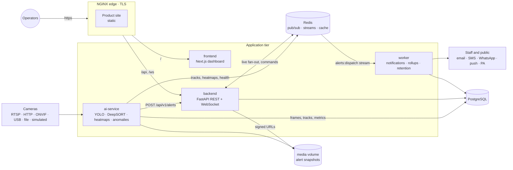

# Architecture

CCD turns CCTV into a live density map and a stream of evidence-backed alerts. Five services and two
data stores, one shared schema package.

## Services

| Service | What it does | Scales |
|---|---|---|
| `backend` | REST API, JWT auth with role permissions, the WebSocket gateway, alert ingest and grouping, signed media URLs, Prometheus metrics. | Horizontally. Every replica runs its own Redis-to-WebSocket bridge. |
| `ai-service` | Reconciles the camera table, runs one capture and inference worker per camera, projects people onto the floor plan, builds density heatmaps and isolines, runs the twelve anomaly detectors and writes evidence snapshots. | One replica (it owns all camera workers). Scale up with a bigger GPU or shard cameras across deployments. |
| `worker` | Dispatches alerts to staff (by role and severity) and the public (by distance from the incident), runs minute rollups into `analytics_metrics`, applies retention, backfills demo history. | Horizontally. A Redis consumer group gives each alert to one replica. Periodic jobs take a Redis claim. |
| `frontend` | Operator dashboard: overview, camera wall, 3D and plan facility map, alerts, analytics, notifications, system health, settings, users, public subscribe page. | Horizontally (stateless). |
| `edge` | NGINX: TLS, HTTP to HTTPS, the static product site, proxying to the dashboard, API and WebSocket, edge rate limits, security headers. | Horizontally. |

`packages/common` holds the SQLAlchemy models, enums, the permission catalogue and Pydantic message
schemas. Every Python service imports it, so the producer and the consumer of a table or a Redis
message cannot disagree about its shape.

## From a frame to an alert

1. **Capture.** `capture/source.py` opens the stream (OpenCV, with reconnect backoff). The simulated
   source renders a crowd moving through the demo station with Poisson arrivals and sidestep avoidance.
2. **Detect and track.** YOLO finds people (lazy-loaded, CUDA when present) and DeepSORT gives each a
   track ID. Weights are cached on the models volume.
3. **Project.** Each camera's position, yaw, tilt, field of view and range place foot points on the
   floor plan in metres (`density/geometry.py`), so tracks from several cameras share one coordinate
   space.
4. **Measure.** `perception` computes speed, heading and dwell per track. `heatmap/engine.py`
   accumulates a per-floor density grid (people/m²), smooths it and publishes it with isolines once a
   second.
5. **Detect anomalies.** `anomaly/engine.py` runs twelve detectors: panic, running, stampede risk,
   fighting, rapid density increase, congestion, counter-flow, abnormal stopping, suspicious gathering,
   restricted-area intrusion, loitering and abandoned objects. Each alert key has a cooldown.
   Thresholds come from the AI settings page and apply without a restart.
6. **Evidence.** `anomaly/reporter.py` writes an annotated snapshot (people involved boxed, everyone
   else dimmed) and posts the alert to the backend with the internal service key.
7. **Ingest and group.** The backend stores the event and the alert. A repeat of the same type on the
   same camera and zone within ten minutes joins the open alert instead (`occurrences`,
   `last_seen_at`). Only an escalation in severity notifies again.
8. **Fan out.** The alert is published on `stream:alerts` (live dashboards) and appended to the
   `alerts:dispatch` Redis Stream (durable, for the worker).
9. **Notify.** The worker routes by severity and audience, sends through the configured providers
   with retries, and records every delivery in `notification_history`.

## Real-time path

The ai-service publishes on `stream:*` channels. Each backend replica's bridge subscribes only to the
channels some connected client wants, serialises each message once and hands it to every subscriber's
bounded queue. A slow client drops its own messages, not everyone's.

| Redis name | Kind | Producer → consumer |
|---|---|---|
| `stream:detections:<camera>` | pub/sub | ai-service → dashboards (camera tile boxes and preview frame) |
| `stream:tracks:<camera>` | pub/sub | ai-service → dashboards (people on the map) |
| `stream:health:<camera>` | pub/sub | ai-service → dashboards (fps, latency, status) |
| `stream:heatmap:<floor>` | pub/sub | ai-service → dashboards (density grid and isolines) |
| `stream:anomalies:<camera>` | pub/sub | ai-service → dashboards |
| `stream:alerts` | pub/sub | backend → dashboards (created and updated alerts) |
| `stream:camera-commands` | pub/sub | backend → ai-service (start, stop, reconfigure a camera) |
| `alerts:dispatch` | stream + consumer group | backend → worker (exactly-once dispatch, pending entries reclaimed after 60 s) |
| `heatmap:<floor>` | key with TTL | ai-service → backend (snapshot for a new subscriber) |
| `camera:health:<camera>` | key | ai-service → backend |
| `ai-service:heartbeat`, `worker:heartbeat` | keys with TTL | services → system health page |
| `ratelimit:login:*` | counters with TTL | backend sign-in throttling |

Redis is a fan-out and coordination layer, not the system of record. If Redis is unavailable, API
writes still commit and live views catch up from the database.

## Security model

- **Identity.** Access tokens (JWT, 30 min) carry the role and its permissions. Refresh tokens (14
  days) are stored hashed and revoked on logout. A guest session is a short-lived token with view
  permissions only.
- **Roles.** `admin` (everything), `supervisor` (cameras, map, alerts, analytics, notifications, AI
  settings), `security_officer` (view plus acknowledge and resolve alerts), `viewer` (read only) and
  `guest` (cameras, map, analytics).
- **Service to service.** The ai-service and the worker call internal endpoints with
  `X-Internal-Api-Key`. Camera stream credentials are encrypted at rest with Fernet.
- **WebSocket.** The token is sent in the first frame, never in the URL. Every topic is checked
  against a permission, and an expired token closes the socket with code 4401.
- **Media.** Snapshots are served only through short-lived HMAC-signed URLs.
- **Edge and API hardening.** TLS 1.2+, HSTS, frame denial, nosniff, a strict CSP on API responses,
  login limits at NGINX (10/min per address) and in the backend (per account and per address,
  failing open if Redis is down), `/metrics` refused at the edge. Containers run unprivileged.
  A production boot refuses any development secret or `DEBUG`.
- **Privacy.** No face recognition. People are boxes, track IDs and floor coordinates. Track points
  and frames are deleted by the retention job.

## Design decisions

- **One schema package.** The backend and the ai-service both write the same tables. Shared models
  remove a whole class of drift bugs. Portable `GUID` and `PortableJSON` types let the same models run
  on SQLite in the unit tests.
- **Simulated cameras are first-class.** A simulated stream type renders a moving crowd, so the full
  pipeline, the alerts and the dashboard can be shown and tested without hardware or a GPU.
- **Grouping in the backend, cooldowns in the detector.** Cooldowns stop a detector firing every
  frame. Grouping turns minutes of a continuing incident into one alert with a count, which is what
  an operator can act on.
- **Streams for dispatch, pub/sub for display.** Notifications must survive a worker restart, and live
  views must not queue up. The two needs use two Redis primitives.
