# Database

PostgreSQL 16, schema managed by Alembic (`apps/backend/alembic`). The models live in
`packages/common/common/models` and are shared by every service. The diagram below is generated from
those models, so it matches what migrations create.

```mermaid
erDiagram
    alerts {
        uuid event_id FK
        uuid camera_id FK
        uuid zone_id FK
        enum alert_type
        enum severity
        enum status
        string title
        string description
        float map_x
        float map_y
        float confidence
        string snapshot_url
        string clip_url
        json metadata_json
        uuid acknowledged_by FK
        datetime acknowledged_at
        datetime resolved_at
        uuid id PK
        datetime created_at
        datetime updated_at
    }
    analytics_metrics {
        enum scope_type
        uuid scope_id
        string metric_name
        float value
        datetime timestamp
        uuid id PK
    }
    buildings {
        string name
        string description
        string address
        float latitude
        float longitude
        uuid id PK
        datetime created_at
        datetime updated_at
    }
    cameras {
        string code
        string name
        string description
        enum stream_type
        string stream_url
        string stream_username
        string stream_password_encrypted
        integer onvif_port
        uuid building_id FK
        uuid floor_id FK
        uuid zone_id FK
        float latitude
        float longitude
        float map_x
        float map_y
        float map_z
        float orientation_deg
        float tilt_deg
        float fov_deg
        float range_m
        enum status
        float fps
        float latency_ms
        datetime last_seen_at
        string last_error
        json config
        boolean is_active
        uuid created_by FK
        uuid id PK
        datetime created_at
        datetime updated_at
    }
    detection_frames {
        uuid camera_id FK
        datetime captured_at
        integer person_count
        float density_value
        float avg_confidence
        float inference_ms
        json boxes
        uuid id PK
    }
    events {
        uuid camera_id FK
        uuid zone_id FK
        uuid track_id FK
        enum event_type
        json payload
        datetime occurred_at
        uuid id PK
    }
    floors {
        uuid building_id FK
        string name
        integer level_index
        float width_m
        float depth_m
        json layout
        uuid id PK
        datetime created_at
        datetime updated_at
    }
    geofence_subscriptions {
        uuid user_id FK
        string display_name
        string device_token
        string phone_number
        string email
        float latitude
        float longitude
        float radius_m
        json channels
        boolean is_active
        string unsubscribe_token
        uuid id PK
        datetime created_at
        datetime updated_at
    }
    notification_history {
        uuid alert_id FK
        enum channel
        string recipient
        enum status
        string provider
        json provider_response
        datetime sent_at
        datetime created_at
        uuid id PK
    }
    permissions {
        string code
        string description
        uuid id PK
        datetime created_at
        datetime updated_at
    }
    refresh_tokens {
        uuid user_id FK
        string token_hash
        datetime expires_at
        boolean revoked
        datetime created_at
        uuid id PK
    }
    role_permissions {
        uuid role_id PK
        uuid permission_id PK
    }
    roles {
        string name
        string description
        uuid id PK
        datetime created_at
        datetime updated_at
    }
    settings {
        string key PK
        json value
        datetime created_at
        datetime updated_at
    }
    system_logs {
        enum level
        string source
        string message
        json context
        datetime created_at
        uuid id PK
    }
    track_points {
        uuid track_id FK
        datetime ts
        float map_x
        float map_y
        json bbox
        float speed_mps
        float direction_deg
        uuid id PK
    }
    tracks {
        uuid camera_id FK
        integer local_track_id
        uuid global_person_id
        enum status
        datetime first_seen_at
        datetime last_seen_at
        float dwell_time_s
        float last_map_x
        float last_map_y
        float last_speed_mps
        float last_direction_deg
        json appearance_embedding
        uuid id PK
    }
    users {
        string email
        string hashed_password
        string full_name
        uuid role_id FK
        boolean is_active
        boolean is_guest
        string phone_number
        boolean notify_enabled
        datetime last_login_at
        uuid id PK
        datetime created_at
        datetime updated_at
    }
    zones {
        uuid floor_id FK
        string name
        enum zone_type
        json polygon
        string color
        integer capacity_threshold
        boolean is_restricted
        uuid id PK
        datetime created_at
        datetime updated_at
    }
    alerts ||--o{ notification_history : "alert_id"
    buildings ||--o{ cameras : "building_id"
    buildings ||--o{ floors : "building_id"
    cameras ||--o{ alerts : "camera_id"
    cameras ||--o{ detection_frames : "camera_id"
    cameras ||--o{ events : "camera_id"
    cameras ||--o{ tracks : "camera_id"
    events ||--o{ alerts : "event_id"
    floors ||--o{ cameras : "floor_id"
    floors ||--o{ zones : "floor_id"
    permissions ||--o{ role_permissions : "permission_id"
    roles ||--o{ role_permissions : "role_id"
    roles ||--o{ users : "role_id"
    tracks ||--o{ events : "track_id"
    tracks ||--o{ track_points : "track_id"
    users ||--o{ alerts : "acknowledged_by"
    users ||--o{ cameras : "created_by"
    users ||--o{ geofence_subscriptions : "user_id"
    users ||--o{ refresh_tokens : "user_id"
    zones ||--o{ alerts : "zone_id"
    zones ||--o{ cameras : "zone_id"
    zones ||--o{ events : "zone_id"
```



## Tables by area

| Area | Tables | Notes |
|---|---|---|
| Identity | `users`, `roles`, `permissions`, `role_permissions`, `refresh_tokens` | Permissions are seeded from `common.rbac`. Refresh tokens are stored as SHA-256 hashes. |
| Facility | `buildings`, `floors`, `zones`, `cameras` | Floor coordinates are metres from the south-west corner. Zones are polygons with a type (entrance, exit, restricted, ...) and a capacity. Cameras carry position, yaw, tilt, field of view and range for floor projection. |
| Perception | `detection_frames`, `tracks`, `track_points` | Written by the ai-service in batches. High volume, so the worker deletes them: track points after 7 days, frames after 14 (`RETENTION_DAYS_*`). |
| Incidents | `events`, `alerts` | Every anomaly is an event. The actionable part is an alert with severity, status, location, snapshot and `metadata` (track IDs, floor, `occurrences`, `last_seen_at`). |
| Notifications | `notification_history`, `geofence_subscriptions` | One row per delivery attempt with the provider response. Public subscribers have a location, radius and unsubscribe token. |
| Analytics | `analytics_metrics` | Minute rollups per camera, zone, floor and building (people average and peak, density, peak density), written by the worker and kept 400 days. Charts and CSV export read from here. |
| Operations | `settings`, `system_logs` | Runtime settings (AI thresholds, routing) read live by the services. |

## Indexes worth knowing

- `alerts`: `camera_id`, `alert_type`, `severity`, `status`. The list view filters on status and
  severity, and grouping looks up the latest open alert by type, camera and zone.
- `analytics_metrics`: `(scope_type, scope_id)` and `metric_name`, plus the bucket time for range scans.
- `tracks`: `camera_id`, `status`, `last_seen_at`, `global_person_id`.

## Migrations

```bash
# after changing a model in packages/common
docker compose build backend migrate
docker compose run --name ccd-migrate-gen migrate alembic revision --autogenerate -m "describe it"
docker cp ccd-migrate-gen:/srv/apps/backend/alembic/versions/. apps/backend/alembic/versions/
docker rm ccd-migrate-gen
```

Review every autogenerated file. Postgres enum changes need hand-written SQL (see
`4a7c1e2b9d10_simulated_stream_type.py`), and a downgrade must drop the enum types it created. CI
runs `upgrade head`, `downgrade base`, `upgrade head` on a real Postgres to catch both.
